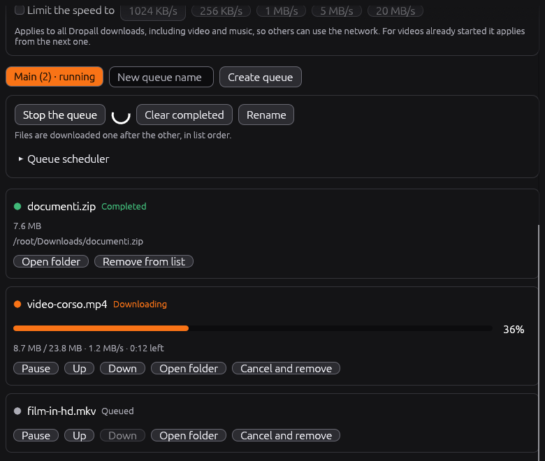
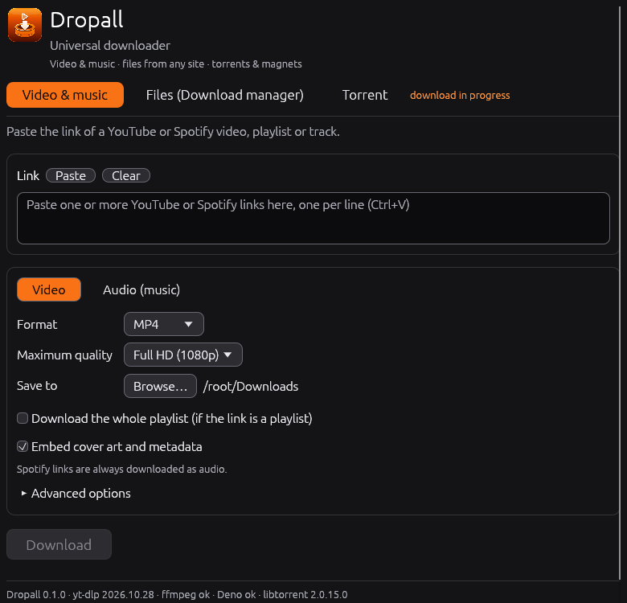
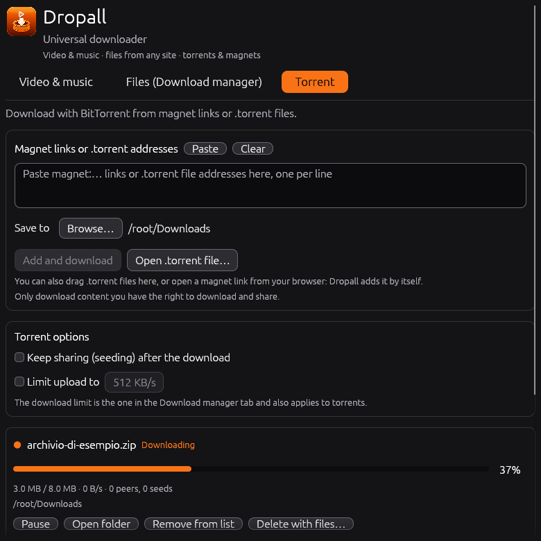

This program was written with the help of [Claude](https://claude.ai), Anthropic's AI assistant.

## Dropall — one app to download everything

Videos, music, files and torrents: paste a link, press a button, and Dropall does the rest. It works on Windows, Linux and macOS.

  

### What's new
- **Torrents are here.** There's a new “Torrent” tab. Paste a magnet link or a `.torrent` address, open a `.torrent` file from your computer (or drag it onto the window), or just click a magnet link in your browser. Dropall opens, or comes to the front if it's already running, and starts it. Torrents pick up where they left off after a restart, and you can keep sharing them afterwards. On Windows the installer can set Dropall as the app for magnet links and `.torrent` files; on Linux the menu entry does it. On macOS, use paste, the open button or drag and drop.
- **Keep downloading while it's out of the way.** Minimize Dropall and it tucks itself into the system tray; videos, files and torrents keep downloading. Click the icon to bring it back. You can turn this off at the bottom of the window.
- **See how far along you are.** Every progress bar now shows its percentage.
- **Easier to understand.** Three tabs (“Video & music”, “Files”, “Torrent”), each with a short line saying what it's for.
- **New name, new icon.** The program is now called Dropall.
- **Windows installer.** `Dropall-Setup-windows-x86_64.exe` installs just for you, with no administrator rights, adds a Start menu entry and an uninstaller. The portable `.exe` is still there.
- **A real download manager.** Download any file from a web link with up to 16 connections at once, line files up in queues, schedule when each queue runs, and set one speed limit for everything. You can pause and resume even after closing the app.
- **Tidier playlists.** A YouTube playlist goes into a folder with the playlist's name.
- **Updates on its own.** Dropall checks for a new version as soon as it opens, installs it and restarts, and tells you how the check went.
- **Italian or English,** following your system language.
- **Screen reader support** on Windows, macOS and Linux, a title bar that follows your system theme, and easier-to-read selected text.
- **Free software**, released under the GPL-3.0-or-later license. The libraries it uses (libtorrent, Boost, OpenSSL) are credited in the app under “Licenses & credits” and in every download.

<table>
  <tr>
    <td></td>
    <td></td>
    <td></td>
  </tr>
</table>

### Downloads
- **Windows:** `Dropall-Setup-windows-x86_64.exe` (installer) or `dropall-windows-x86_64.exe` (portable)
- **Linux:** `dropall-linux-x86_64.AppImage`
- **macOS:** `Dropall-macos-*.app.zip`

Use Dropall only for content you have the right to download and share. Installed copies update themselves.

### Changes in this version
