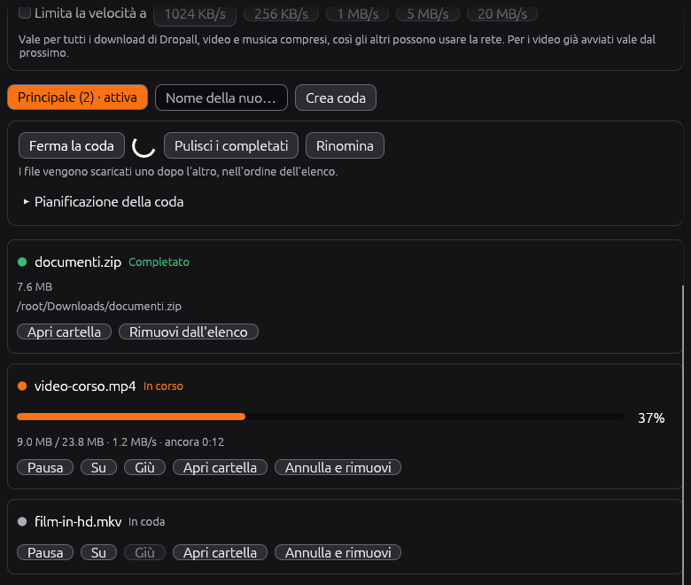
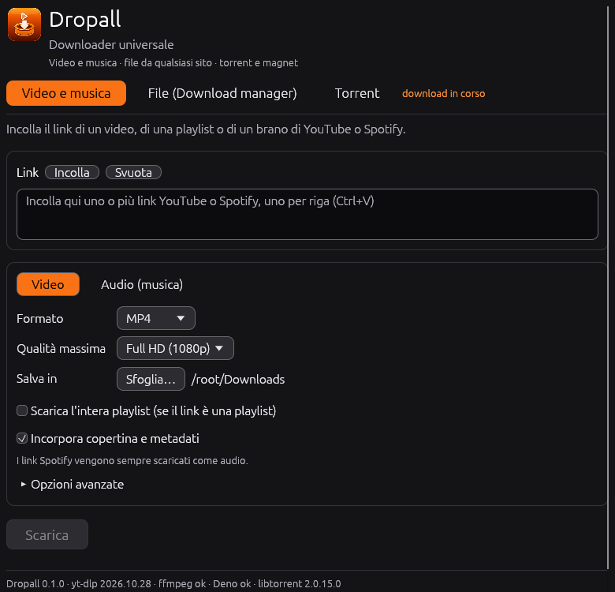
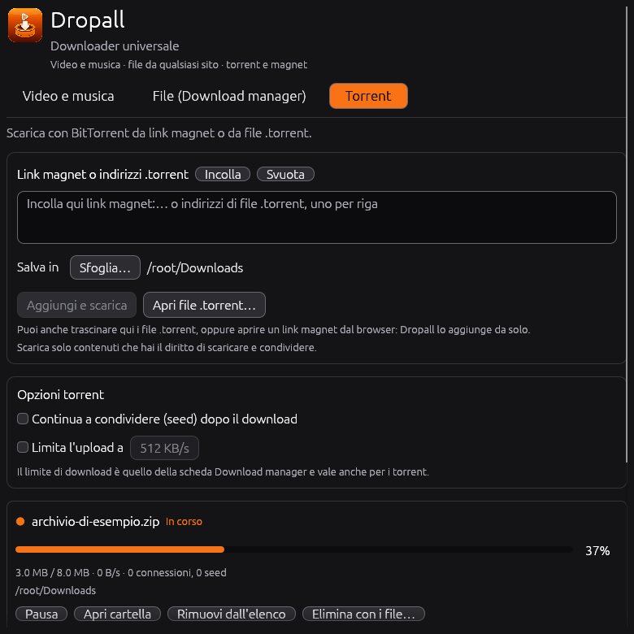

# Dropall

**Un solo programma per scaricare tutto: video, musica, file e torrent.**

[English](README.md) · **Italiano**

<p align="center">
  
</p>

Dropall è un programma gratuito e semplice per scaricare ciò che ti serve da internet. Incolli un link, premi un pulsante e al resto pensa lui:

- **Video e musica** da YouTube e Spotify, nel formato e nella qualità che preferisci.
- **Qualsiasi file** da un indirizzo web, più veloce grazie a più connessioni insieme, con code che puoi pianificare.
- **Torrent**: incolla un link magnet, apri un file `.torrent` oppure clicca un link magnet nel browser.

Funziona su **Windows, Linux e macOS**, è piccolo e leggero (l'AppImage per Linux pesa circa 4 MB), parla **italiano o inglese** in base al tuo sistema e si aggiorna da solo.

<table>
  <tr>
    <td></td>
    <td></td>
    <td></td>
  </tr>
  <tr>
    <td align="center"><sub>Video e musica</sub></td>
    <td align="center"><sub>File (download manager)</sub></td>
    <td align="center"><sub>Torrent</sub></td>
  </tr>
</table>

## Novità

- **Arrivano i torrent.** C'è una nuova scheda *Torrent*: incolla link magnet o indirizzi `.torrent`, apri i file `.torrent` dal computer (o trascinali sulla finestra), oppure clicca un link magnet nel browser e Dropall se ne occupa. Funziona con [libtorrent](https://github.com/arvidn/libtorrent).
- **Scarica anche mentre non lo vedi.** Minimizza Dropall e va nell'area di notifica: video, file e torrent continuano a scaricare.
- **Sai sempre a che punto sei:** ogni barra di avanzamento mostra la percentuale.
- **Interfaccia più chiara:** tre schede (*Video e musica*, *File*, *Torrent*), ognuna con una riga che spiega a cosa serve.
- **Nuovo nome e nuova icona:** il programma ora si chiama Dropall.
- **Installer per Windows** (`Dropall-Setup-windows-x86_64.exe`): si installa solo per il tuo utente, senza diritti di amministratore, con voce nel menu Start e disinstallatore. L'`.exe` portatile resta disponibile.
- **Download manager** per qualsiasi file `http(s)`: fino a 16 connessioni per file, code, pianificatore e un limite di velocità condivisibile.
- **Le playlist** finiscono in una cartella col nome della playlist.
- **Aggiornamenti automatici** all'avvio, con una riga che dice com'è andato il controllo.
- **Supporto per screen reader** su Windows, macOS e Linux, barra del titolo che segue il tema del sistema e testo selezionato più leggibile.

## Cosa fa

**Video e musica**

- Video in MP4, MKV o WebM, con la qualità massima che vuoi (fino a 4K).
- Audio in MP3, M4A (AAC), Opus, OGG Vorbis, FLAC o WAV, con scelta del bitrate.
- Puoi incollare più link insieme (uno per riga) e scegliere dove salvare i file.
- Le playlist vanno in una cartella col nome della playlist, con file chiamati `1 - Titolo.mp4`, `2 - Titolo.mp4`…
- Copertina e metadati vengono inseriti nei file.
- Una coda con avanzamento in tempo reale, percentuale su ogni barra e pulsante **Annulla**.

**Qualsiasi file (download manager)**

- **Più connessioni per file** (da 1 a 16): il file viene diviso in blocchi scaricati in parallelo. Quanto si guadagna dipende dal server (vedi sotto).
- **Code**: quante ne vuoi. Ognuna scarica i suoi file uno dopo l'altro, nell'ordine dell'elenco; puoi spostare, mettere in pausa, riprendere, riprovare e rimuovere.
- **Pianificatore**: una coda può partire e fermarsi da sola agli orari e nei giorni che scegli, anche a cavallo della mezzanotte.
- **Limite di velocità**: un solo tetto per tutti i download (anche video e musica), così gli altri possono usare la rete.
- Pausa e ripresa funzionano anche dopo aver chiuso l'app, se il server lo permette.

**Torrent**

- Tre modi per aggiungere un torrent: incolla **link magnet** o indirizzi `.torrent` (uno per riga); **apri un file `.torrent`** con il pulsante, trascinandolo sulla finestra o con «Apri con»; oppure clicca un **link magnet nel browser**: Dropall si apre, o passa in primo piano se è già in esecuzione, e lo aggiunge.
- I torrent proseguono dopo un riavvio. Puoi continuare a condividere (seed) dopo il download, limitare la velocità di invio (per il download vale il limite condiviso) e rimuovere un torrent con o senza i suoi file.
- L'installer per Windows può registrare Dropall per i link `magnet:` e i file `.torrent` (solo utente corrente); su Linux lo fa la voce del menu applicazioni. Su macOS, per ora, usa incolla, il pulsante di apertura o il trascinamento.

**Area di notifica**

- Con l'opzione in fondo alla finestra (attiva di default), minimizzando Dropall si nasconde nell'area di notifica mentre tutto continua a scaricare. Lo stesso accade se chiudi la finestra mentre c'è qualcosa in download. Clicca l'icona per riaprire la finestra; il menu ha *Mostra* ed *Esci*.
- Su Linux usa lo standard StatusNotifierItem (KDE, Xfce, Cinnamon e GNOME con l'estensione AppIndicator). Se il tuo desktop non ha un'area di notifica, la finestra si minimizza e basta.

**Pensa a tutto da solo**

- **Si prepara da solo**: al primo avvio scarica yt-dlp, ffmpeg e Deno
  (il runtime JavaScript che yt-dlp richiede per YouTube); a ogni avvio
  controlla se esiste un yt-dlp più recente e lo aggiorna.
- **Si aggiorna da solo**: a ogni avvio, subito (senza aspettare il resto), guarda l'ultima
  release GitHub e, se è più recente, la scarica, sostituisce l'app e la riavvia.
  In fondo alla finestra una riga dice sempre com'è andato il controllo.
  Su Linux funziona dall'AppImage; si può disattivare nelle opzioni avanzate.

### Come si comporta il download manager

- Accelera i download solo se il **server accetta più connessioni** e il suo limite è per
  connessione. Se il server ti dà già tutta la velocità della tua linea, o non supporta gli
  intervalli, non andrai più veloce (Dropall usa allora una sola connessione e lo scrive). Il
  «fino al 500 %» che alcuni programmi dichiarano è un caso migliore, non una promessa.
- Alcuni siti rifiutano molte connessioni insieme o chiedono un accesso: usa meno connessioni.
  I link che richiedono cookie o login non sono supportati.
- Il pianificatore funziona con Dropall **aperto**: se l'app è chiusa all'orario previsto non
  parte nulla. Se la apri quando l'orario è già dentro l'intervallo, la coda parte subito.
- Usalo solo per file che hai il diritto di scaricare.

### Come si comportano i torrent

- BitTorrent condivide dati con altre persone: mentre un torrent scarica (e mentre fa da seed, se lo scegli) il
  computer invia dati ad altri. Usa il limite di upload se serve e scarica solo contenuti che hai il diritto di
  scaricare e condividere.
- Per trovare i peer serve la rete: un link magnet cerca prima le informazioni del torrent tramite tracker e DHT,
  e può richiedere un po'. Lo stato mostra *Ricerca informazioni* finché non le trova.
- La prima volta firewall o router possono chiedere di Dropall; usa la porta 6881 e prova UPnP/NAT-PMP.

### Come funziona Spotify

Spotify cifra l'audio (DRM) e yt-dlp non lo scarica. Dropall legge soltanto i
**dati pubblici** del link (titolo e artista di brano, album o playlist), poi
**cerca lo stesso brano su YouTube** e scarica l'audio da lì. Quindi:

- il risultato è l'audio della versione YouTube, non il file originale Spotify;
- una playlist può mostrare al massimo circa 100 brani;
- se Spotify cambia la struttura delle sue pagine pubbliche, la lettura dei link
  può smettere di funzionare finché non si aggiorna Dropall.

> Usa Dropall solo per contenuti che hai il diritto di scaricare e nel rispetto
> del copyright e dei termini di servizio delle piattaforme.

## Installazione

| Sistema | File dalla pagina *Releases* | Note |
|---|---|---|
| Windows (installer) | `Dropall-Setup-windows-x86_64.exe` | **consigliato**: installa solo per il tuo utente (nessun permesso di amministratore), aggiunge la voce nel menu Start e un disinstallatore, icona sul desktop facoltativa; poi l'app si aggiorna da sola. SmartScreen può avvisare perché non è firmato |
| Windows (portatile) | `dropall-windows-x86_64.exe` | senza installazione: doppio clic e via |
| Linux | `dropall-linux-x86_64.AppImage` | `chmod +x` e doppio clic (l'auto-aggiornamento funziona solo da AppImage) |
| macOS | `Dropall-macos-aarch64.app.zip` (Apple Silicon) oppure `…-x86_64.app.zip` (Intel) | decomprimi, trascina in *Applicazioni*; la prima volta tasto destro → Apri (l'app non è notarizzata). Se macOS la dichiara «danneggiata»: `xattr -cr /Applications/Dropall.app` |

Dati e strumenti scaricati stanno in:
Windows `%APPDATA%\Dropall\Dropall\data`, Linux `~/.local/share/dropall`,
macOS `~/Library/Application Support/org.Dropall.Dropall`.

## Creare una release

Le versioni per Windows, Linux e macOS si compilano **su GitHub**, in automatico
(`.github/workflows/release.yml`). Non serve nessun programma installato sul tuo PC.

### Preparazione (una volta sola)

1. Crea un repository su GitHub e caricaci il progetto (compresa la cartella `.github`).
2. Non serve modificare `Cargo.toml`: le versioni compilate da GitHub cercano gli
   aggiornamenti nel repository stesso da cui sono state compilate. (Solo se compili in
   locale, imposta `repository` in `Cargo.toml` con il tuo indirizzo GitHub.)
3. Su GitHub: *Settings → Actions → General → Workflow permissions* e scegli
   **Read and write permissions** (serve per creare tag e release).

### Ogni volta che vuoi pubblicare una versione

**Prima** modifica `.github/release-notes.md`: il suo testo diventa la parte alta delle note di rilascio
   (GitHub aggiunge sotto l'elenco automatico delle modifiche) e si vede anche nel pannello «Novità»
   dell'app. Lascia la prima riga (il credito a Claude): su GitHub si vede, nell'app è nascosta.

1. Su GitHub apri la scheda **Actions** → a sinistra **Release** → **Run workflow**.
2. Nel campo *Nuova versione* scrivi il numero, per esempio `0.2.0`, e conferma.
3. Aspetta 10-20 minuti. Il workflow, da solo:
   - aggiorna la versione in `Cargo.toml`/`Cargo.lock` e crea il tag `v0.2.0`;
   - compila Windows, Linux e macOS (Intel e Apple Silicon);
   - pubblica la release nella pagina **Releases** con tutti i file.
4. Le app già installate trovano la nuova release al prossimo avvio e si aggiornano.

I numeri seguono il formato `maggiore.minore.patch`: `0.1.0` → `0.1.1` per una
correzione, `0.2.0` per una novità, `1.0.0` per la prima versione stabile.
Una versione già usata non si può ripubblicare: scegline una più alta.

**Alternative**

- *Da terminale*: alza `version` in `Cargo.toml`, fai commit, poi
  `git tag v0.2.0 && git push --tags`. Parte lo stesso workflow
  (il tag deve coincidere con la versione di `Cargo.toml`, altrimenti si ferma).
- *Solo prova*: *Run workflow* lasciando **vuoto** il campo versione. Compila tutto
  e lascia i file in *Artifacts* a fondo pagina, senza pubblicare nulla.

### File prodotti (nomi da non cambiare: li cerca l'aggiornamento automatico)

| File | A cosa serve |
|---|---|
| `Dropall-Setup-windows-x86_64.exe` | installer Windows (nuove installazioni) |
| `dropall-windows-x86_64.exe` | Windows portatile, usato anche dagli aggiornamenti automatici |
| `dropall-linux-x86_64.AppImage` | Linux Intel/AMD |
| `dropall-linux-aarch64.AppImage` | Linux ARM (solo se il repository è pubblico) |
| `Dropall-macos-aarch64.app.zip` / `Dropall-macos-x86_64.app.zip` | macOS, prima installazione |
| `dropall-macos-aarch64` / `dropall-macos-x86_64` | macOS, usati dall'aggiornamento automatico |

### Se qualcosa va storto

- **«Permission denied» o «protected branch»** nel passo *prepare*: i permessi del
  punto 3 della preparazione mancano, oppure il ramo `main` è protetto e non accetta
  commit dal workflow. In quel caso alza la versione a mano e usa il metodo del tag.
- **«Process completed with exit code 126»**: un file di script ha perso il permesso
  di esecuzione nel caricamento (zip/Windows). Il workflow lancia già gli script con
  `bash`, quindi basta usare l'ultima versione dei file.
- **Avvisi «Node.js 20 is deprecated»**: sono solo avvisi di GitHub, non errori.
- **Una build fallisce**: apri il lavoro rosso, leggi l'errore (di solito è nelle
  ultime righe) e correggi il codice. La release non viene pubblicata a metà: esce solo
  se Windows, Linux e macOS riescono. Dopo la correzione, rilancia con una versione nuova
  (se il workflow ha già creato il tag, cancellalo da *Code → Tags* o usa il numero successivo).
- Il workflow **CI** gira a ogni push e controlla formattazione, avvisi e test su
  tutti e tre i sistemi, così gli errori si vedono prima della release.

## Accessibilità

Dropall rende la sua interfaccia disponibile agli screen reader tramite
[AccessKit](https://github.com/AccessKit/accesskit): Narrator e NVDA su Windows,
VoiceOver su macOS, Orca su Linux. Pulsanti, campi, elenchi e barre di avanzamento hanno nome
e ruolo, il campo del link ha un'etichetta, lo stato dei download è detto anche a parole
(in attesa, in corso, completato, non riuscito) e non solo con il colore, e tutto si
raggiunge da tastiera (Tab / Maiusc+Tab, Spazio o Invio). La dimensione del testo si
aumenta dalle opzioni avanzate. Se trovi qualcosa che uno screen reader non legge bene,
apri una segnalazione.

## Compilare in locale su Windows

Con Rust installato (<https://rustup.rs>) fai doppio clic su `packaging\windows\build.bat`:
crea `dropall-windows-x86_64.exe` e, se è installato [Inno Setup 6](https://jrsoftware.org/isinfo.php), anche
l'installer `Dropall-Setup-windows-x86_64.exe`.

## Compilare da sorgente

```bash
cargo run --release                      # avvio
cargo test                               # test unitari
packaging/linux/build-appimage.sh        # crea l'AppImage (Linux)
python3 scripts/make_icon.py             # rigenera le icone (serve Pillow)
```

Serve Rust 1.85+. Servono anche **CMake**, un compilatore C++17 e gli header di **Boost** (il motore torrent,
libtorrent, viene compilato dentro il programma; OpenSSL lo compila da sorgente il crate `openssl-src`, che richiede
`perl` e `make`: non serve OpenSSL di sistema). Imposta `DROPALL_BOOST_ROOT` su una cartella che contiene `boost/`,
oppure installa il pacchetto di sistema (`libboost-dev`, `brew install boost`). Su Windows usa il prompt
*x64 Native Tools* (MSVC) e i sorgenti di Boost. Per compilare senza torrent (senza CMake/Boost):
`cargo build --release --no-default-features`. Se Boost non si trova, lo script di build scarica gli header da solo (serve internet; con `DROPALL_BOOST_URL` si indica un mirror).

Prove con yt-dlp reale (facoltative):

```bash
DROPALL_YTDLP=/percorso/yt-dlp cargo test -- --ignored
```

Per forzare la lingua dell'interfaccia (prove): `DROPALL_LANG=it` oppure `DROPALL_LANG=en`.

## Struttura

| File | Compito |
|---|---|
| `src/app.rs` | interfaccia grafica (egui) |
| `src/downloader.rs` | costruisce i comandi yt-dlp, legge l'avanzamento, annulla |
| `src/dm.rs` | motore del download manager: più connessioni, code, pianificatore, limite |
| `src/app/dm_tab.rs` | scheda del download manager |
| `src/app/torrent_tab.rs` | scheda Torrent |
| `src/torrent.rs` | lato Rust del motore torrent (sessione, link, file `.torrent`) |
| `native/gt.cpp` | piccolo strato C++ su libtorrent |
| `third_party/libtorrent` | sorgenti di libtorrent (BSD-3-Clause), vedi *Licenza* |
| `src/tray.rs` | icona nell'area di notifica |
| `src/ipc.rs` | istanza unica: passa link magnet e file `.torrent` all'app già aperta |
| `src/tools.rs` | scarica/aggiorna yt-dlp, Deno, ffmpeg |
| `src/spotify.rs` | legge titolo/artista dai link Spotify |
| `src/selfupdate.rs` | aggiornamento automatico dell'app |
| `src/config.rs` | impostazioni salvate |
| `src/i18n.rs` | lingua dell'interfaccia (italiano / inglese) |
| `docs/screenshots/` | screenshot usati in questo file e nelle note di rilascio |

## Problemi comuni

- **L'aggiornamento automatico non parte**: leggi la riga di stato in fondo alla finestra.
  Dice se Dropall è già aggiornato, se non c'è nessuna release (o il repository è privato:
  l'app non può leggerlo, serve un repository pubblico), se GitHub ha limitato le richieste,
  o se la release non contiene il file per il tuo sistema. Il pulsante *Controlla
  aggiornamenti di Dropall* nelle opzioni avanzate rifà il controllo subito. Dopo un
  aggiornamento l'app si riavvia una volta sola e non si aggiorna di nuovo in quella
  esecuzione, per evitare cicli.

- **«Sign in to confirm you're not a bot» / video con restrizioni**: in
  *Opzioni avanzate* scegli il browser da cui prendere i cookie.
- **macOS**: ffmpeg viene scaricato in versione Intel (su Apple Silicon usa
  Rosetta); se hai Homebrew (`brew install ffmpeg`) viene usato quello.
- **Linux senza AppImage** (binario avviato a mano): funziona, ma l'app non
  può sostituire se stessa; mostra solo il link alla nuova release.

## Licenza

Dropall è software libero, rilasciato con la
[Licenza Pubblica Generica GNU v3.0 o successive](https://www.gnu.org/licenses/gpl-3.0.html)
(`GPL-3.0-or-later`); vedi `LICENSE`. Puoi usarlo, studiarlo, condividerlo e modificarlo; se
distribuisci versioni modificate, devi rilasciarle con la stessa licenza e con i sorgenti.

### Software di terzi

La funzione torrent include [libtorrent](https://github.com/arvidn/libtorrent) 2.0 (BSD 3-Clause, © Arvid Norberg e
collaboratori; i sorgenti sono in `third_party/libtorrent`), gli header C++ di Boost (Boost Software License 1.0) e
OpenSSL 3 (Apache License 2.0), tutti compilati nel programma e compatibili con la GPL-3.0-or-later. I testi delle licenze sono in
`THIRD_PARTY_LICENSES.txt`, si leggono nell'app (*Licenze e crediti*) e sono inclusi in ogni download.
