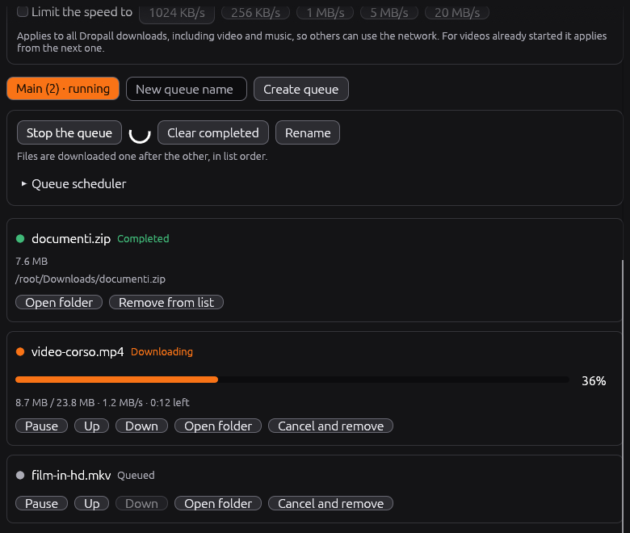
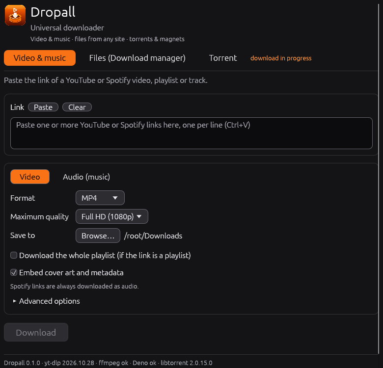
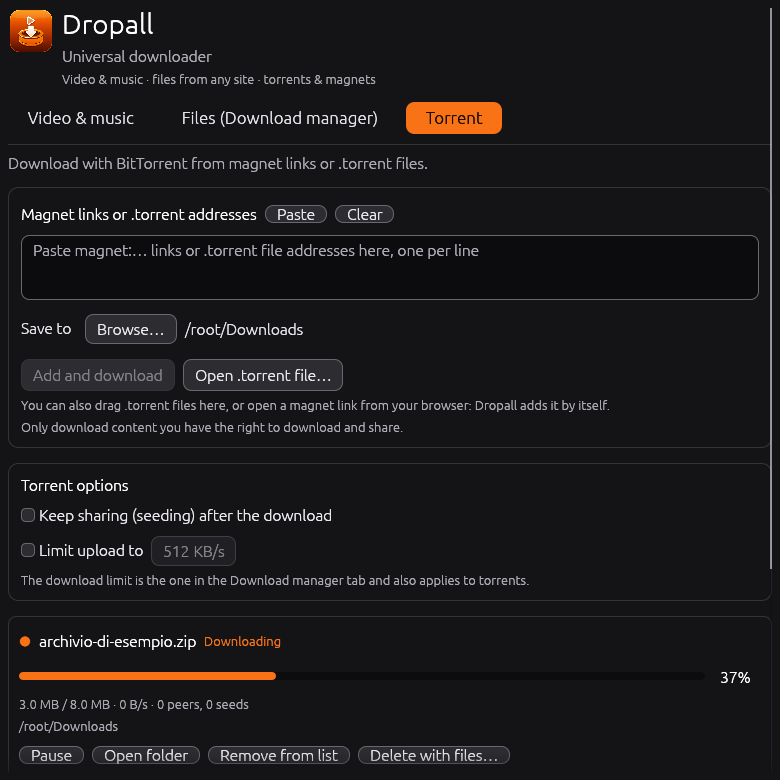

# Dropall

**One app to download everything: videos, music, files and torrents.**

**English** · [Italiano](README.it.md)

<p align="center">
  
</p>

Dropall is a free, simple program for downloading things from the internet. Paste a link, press a button, and it does the rest:

- **Videos and music** from YouTube and Spotify, in the format and quality you choose.
- **Any file** from a web address, faster thanks to several simultaneous connections, with queues you can schedule.
- **Torrents**: paste a magnet link, open a `.torrent` file, or just click a magnet link in your browser.

It runs on **Windows, Linux and macOS**, it is small and lightweight (the Linux AppImage is about 4 MB), it speaks **Italian or English** depending on your system, and it keeps itself up to date.

<table>
  <tr>
    <td></td>
    <td></td>
    <td></td>
  </tr>
  <tr>
    <td align="center"><sub>Video &amp; music</sub></td>
    <td align="center"><sub>Files (download manager)</sub></td>
    <td align="center"><sub>Torrent</sub></td>
  </tr>
</table>

## What's new

- **Torrents have arrived.** There is a new *Torrent* tab: paste magnet links or `.torrent` addresses, open `.torrent` files from your computer (or drag them onto the window), or click a magnet link in your browser and Dropall takes care of it. Powered by [libtorrent](https://github.com/arvidn/libtorrent).
- **Keep downloading while it's out of the way.** Minimize Dropall and it tucks itself into the system tray; videos, files and torrents keep downloading.
- **You always know how far along you are:** every progress bar now shows its percentage.
- **Clearer layout:** three tabs (*Video & music*, *Files*, *Torrent*), each with a one-line explanation of what it is for.
- **A new name and icon:** the program is now called Dropall.
- **Windows installer** (`Dropall-Setup-windows-x86_64.exe`): installs for your user only, with no administrator rights, adds a Start menu entry and an uninstaller. The portable `.exe` is still there.
- **Download manager** for any `http(s)` file: up to 16 connections per file, queues, a scheduler, and a speed limit that you can share across everything.
- **Playlists** are saved in a folder named after the playlist.
- **Automatic updates** at startup, with a line telling you how the check went.
- **Screen reader support** on Windows, macOS and Linux, a title bar that follows your system theme, and clearer selected text.

## What it does

**Videos and music**

- Video as MP4, MKV or WebM, with the maximum quality you want (up to 4K).
- Audio as MP3, M4A (AAC), Opus, OGG Vorbis, FLAC or WAV, with a choice of bitrate.
- Paste several links at once (one per line) and choose where to save the files.
- Playlists go into a folder named after the playlist, with files called `1 - Title.mp4`, `2 - Title.mp4`…
- Cover art and metadata are embedded in the files.
- A queue with live progress, a percentage on every bar and a **Cancel** button.

**Any file (download manager)**

- **Several connections per file** (1 to 16): the file is split into blocks fetched in parallel. How much faster it gets depends on the server (see below).
- **Queues**: create as many as you like. Each one downloads its files one after the other, in the order of the list; you can move, pause, resume, retry and remove items.
- **Scheduler**: a queue can start and stop by itself at the times and days you choose, even across midnight.
- **Speed limit**: one cap for all downloads (video and music too), so other people can use the network.
- Pause and resume still work after closing the app, when the server supports it.

**Torrents**

- Three ways to add a torrent: paste **magnet links** or `.torrent` addresses (one per line); **open a `.torrent` file** with the button, by dragging it onto the window or with "Open with"; or click a **magnet link in your browser**: Dropall opens, or comes to the front if it is already running, and adds it.
- Torrents carry on after a restart. You can keep sharing (seeding) after the download, limit the upload speed (the download limit is the shared one) and remove a torrent with or without its files.
- The Windows installer can register Dropall for `magnet:` links and `.torrent` files (current user only); on Linux the desktop entry does the same. On macOS, for now, use paste, the open button or drag and drop.

**System tray**

- With the option at the bottom of the window (on by default), minimizing hides Dropall in the notification area while everything keeps downloading. Closing the window while something is downloading does the same. Click the icon to bring the window back; its menu has *Show* and *Quit*.
- On Linux this uses the StatusNotifierItem standard (KDE, Xfce, Cinnamon, and GNOME with the AppIndicator extension). If your desktop has no tray, the window simply minimizes.

**It looks after itself**

- **Sets itself up**: on first launch it downloads yt-dlp, ffmpeg and Deno
  (the JavaScript runtime yt-dlp needs for YouTube); on every launch it checks
  whether a newer yt-dlp exists and updates it.
- **Updates itself**: on every launch, right away (without waiting for the rest), it looks at the
  latest GitHub release and, if it is newer, downloads it, replaces the app and restarts it.
  A line at the bottom of the window always tells you how the check went.
  On Linux it works from the AppImage; it can be turned off in the advanced options.

### How the download manager behaves

- It speeds up downloads only when the **server allows several connections** and its limit is
  per connection. If the server already gives you your full line speed, or does not support
  ranges, you will not go faster (Dropall then uses one connection and says so). The "up to
  500 %" that some programs advertise is a best case, not a promise.
- Some sites refuse many simultaneous connections or require a sign-in: use fewer connections.
  Links that need cookies or a login are not supported.
- The scheduler works while Dropall is **open**: if the app is closed at the scheduled time,
  nothing starts. If it is opened when the time is already inside the window, the queue starts
  right away.
- Use it only for files you have the right to download.

### How torrents behave

- BitTorrent shares data with other people: while a torrent downloads (and while it seeds, if you choose so) your
  computer uploads to others. Use the upload limit if needed, and only download content you have the right to download and share.
- Finding peers needs a working network: magnet links first look for the torrent's info through trackers and the DHT,
  which can take a little. The status shows *Fetching info* until it is found.
- The first time, your firewall or router may ask about Dropall; Dropall listens on port 6881 and tries UPnP/NAT-PMP.

### How Spotify works

Spotify encrypts its audio (DRM) and yt-dlp cannot download it. Dropall only reads the
**public data** of the link (title and artist of a track, album or playlist), then
**searches for the same track on YouTube** and downloads the audio from there. So:

- the result is the audio of the YouTube version, not the original Spotify file;
- a playlist can show at most about 100 tracks;
- if Spotify changes the structure of its public pages, reading links may stop
  working until Dropall is updated.

> Use Dropall only for content you have the right to download and in compliance with
> the copyright and terms of service of the platforms.

## Installation

| System | File from the *Releases* page | Notes |
|---|---|---|
| Windows (installer) | `Dropall-Setup-windows-x86_64.exe` | **recommended**: installs for your user only (no administrator rights), adds a Start menu entry and an uninstaller, optional desktop icon; the app updates itself afterwards. SmartScreen may warn because it is not signed |
| Windows (portable) | `dropall-windows-x86_64.exe` | no installation: double-click and go |
| Linux | `dropall-linux-x86_64.AppImage` | `chmod +x` and double-click (auto-update only works from the AppImage) |
| macOS | `Dropall-macos-aarch64.app.zip` (Apple Silicon) or `…-x86_64.app.zip` (Intel) | unzip, drag into *Applications*; the first time right-click → Open (the app is not notarized). If macOS calls it "damaged": `xattr -cr /Applications/Dropall.app` |

Data and downloaded tools are stored in:
Windows `%APPDATA%\Dropall\Dropall\data` (the installer puts the program in `%LOCALAPPDATA%\Programs\Dropall`), Linux `~/.local/share/dropall`,
macOS `~/Library/Application Support/org.Dropall.Dropall`.

## Creating a release

The Windows, Linux and macOS versions are built **on GitHub**, automatically
(`.github/workflows/release.yml`). Nothing needs to be installed on your PC.

### Preparation (once)

1. Create a repository on GitHub and upload the project (including the `.github` folder).
2. You do not need to edit `Cargo.toml`: the versions built by GitHub look for
   updates in the very repository they were built from. (Only if you build locally,
   set `repository` in `Cargo.toml` to your GitHub address.)
3. On GitHub: *Settings → Actions → General → Workflow permissions* and choose
   **Read and write permissions** (needed to create tags and releases).

### Every time you want to publish a version

**First**, edit `.github/release-notes.md`: its text becomes the top of the release notes (GitHub adds the
   automatic list of changes below it) and is also shown in the app's "What's new" panel.
   Keep the first line (the credit to Claude): it is shown on GitHub and hidden in the app.

1. On GitHub open the **Actions** tab → **Release** on the left → **Run workflow**.
2. In the *New version* field type the number, for example `0.2.0`, and confirm.
3. Wait 10-20 minutes. The workflow, by itself:
   - updates the version in `Cargo.toml`/`Cargo.lock` and creates the tag `v0.2.0`;
   - builds Windows, Linux and macOS (Intel and Apple Silicon);
   - publishes the release on the **Releases** page with all the files.
4. Apps that are already installed find the new release on their next launch and update.

Numbers follow the `major.minor.patch` format: `0.1.0` → `0.1.1` for a fix,
`0.2.0` for a new feature, `1.0.0` for the first stable version.
A version that has already been used cannot be published again: pick a higher one.

**Alternatives**

- *From a terminal*: raise `version` in `Cargo.toml`, commit, then
  `git tag v0.2.0 && git push --tags`. The same workflow starts
  (the tag must match the version in `Cargo.toml`, otherwise it stops).
- *Test only*: *Run workflow* leaving the version field **empty**. It builds everything
  and leaves the files in *Artifacts* at the bottom of the page, publishing nothing.

### Files produced (do not rename them: automatic updates look for these names)

| File | Purpose |
|---|---|
| `Dropall-Setup-windows-x86_64.exe` | Windows installer (new installations) |
| `dropall-windows-x86_64.exe` | Windows portable, also used by automatic updates |
| `dropall-linux-x86_64.AppImage` | Linux Intel/AMD |
| `dropall-linux-aarch64.AppImage` | Linux ARM (only if the repository is public) |
| `Dropall-macos-aarch64.app.zip` / `Dropall-macos-x86_64.app.zip` | macOS, first installation |
| `dropall-macos-aarch64` / `dropall-macos-x86_64` | macOS, used by automatic updates |

### If something goes wrong

- **"Permission denied" or "protected branch"** in the *prepare* step: the permissions in
  step 3 of the preparation are missing, or the `main` branch is protected and does not accept
  commits from the workflow. In that case raise the version by hand and use the tag method.
- **"Process completed with exit code 126"**: a script file lost its execute permission
  during upload (zip/Windows). The workflow already runs scripts with `bash`,
  so using the latest version of the files is enough.
- **"Node.js 20 is deprecated" warnings**: they are just GitHub warnings, not errors.
- **A build fails**: open the red job and read the error (usually in the last lines),
  then fix the code. The release is never published halfway: it only goes out if Windows,
  Linux and macOS all succeed. After the fix, run again with a new version
  (if the workflow already created the tag, delete it from *Code → Tags* or use the next number).
- The **CI** workflow runs on every push and checks formatting, warnings and tests on
  all three systems, so errors show up before the release.

## Accessibility

Dropall exposes its interface to screen readers through
[AccessKit](https://github.com/AccessKit/accesskit): Narrator and NVDA on Windows,
VoiceOver on macOS, Orca on Linux. Buttons, fields, lists and progress bars have names and
roles, the link field is labelled, the download state is also spoken in words (waiting,
in progress, completed, failed) and not only shown with colour, and everything can be
reached with the keyboard (Tab / Shift+Tab, Space or Enter). Text size can be increased in
the advanced options. If you find something a screen reader does not read correctly,
please open an issue.

## Building locally on Windows

With Rust installed (<https://rustup.rs>) double-click `packaging\windows\build.bat`:
it creates `dropall-windows-x86_64.exe` and, if [Inno Setup 6](https://jrsoftware.org/isinfo.php) is installed,
also the installer `Dropall-Setup-windows-x86_64.exe`.

## Building from source

```bash
cargo run --release                      # run
cargo test                               # unit tests
packaging/linux/build-appimage.sh        # create the AppImage (Linux)
python3 scripts/make_icon.py             # regenerate the icons (needs Pillow)
```

Requires Rust 1.85+, **CMake**, a C++17 compiler and the **Boost** headers (the torrent engine, libtorrent, is
compiled in; OpenSSL is built from source by the `openssl-src` crate, which needs `perl` and `make`; no system
OpenSSL needed). Point `DROPALL_BOOST_ROOT` to a folder that contains `boost/`, or install the system package
(`libboost-dev`, `brew install boost`). On Windows use the *x64 Native Tools* prompt (MSVC) and a Boost source tree.
To build without torrent support (no CMake/Boost needed): `cargo build --release --no-default-features`.
If no Boost is found, the build script downloads the headers by itself (needs internet; set `DROPALL_BOOST_URL` to use a mirror).

Tests against a real yt-dlp (optional):

```bash
DROPALL_YTDLP=/path/to/yt-dlp cargo test -- --ignored
```

To force the interface language (for testing): `DROPALL_LANG=it` or `DROPALL_LANG=en`.

## Structure

| File | Purpose |
|---|---|
| `src/app.rs` | graphical interface (egui) |
| `src/downloader.rs` | builds the yt-dlp commands, reads progress, cancels |
| `src/dm.rs` | download manager engine: multi-connection, queues, scheduler, speed limit |
| `src/app/dm_tab.rs` | download manager tab |
| `src/app/torrent_tab.rs` | torrent tab |
| `src/torrent.rs` | Rust side of the torrent engine (session, links, `.torrent` files) |
| `native/gt.cpp` | small C++ layer over libtorrent |
| `third_party/libtorrent` | libtorrent source (BSD-3-Clause), see *License* |
| `src/tray.rs` | system tray icon |
| `src/ipc.rs` | single instance: forwards magnet links and `.torrent` files to the running app |
| `src/tools.rs` | downloads/updates yt-dlp, Deno, ffmpeg |
| `src/spotify.rs` | reads title/artist from Spotify links |
| `src/selfupdate.rs` | automatic app updates |
| `src/config.rs` | saved settings |
| `src/i18n.rs` | interface language (Italian / English) |
| `docs/screenshots/` | screenshots used in this file and in the release notes |

## Common problems

- **Automatic update does not start**: read the status line at the bottom of the window.
  It says whether Dropall is already up to date, whether there is no release (or the repository
  is private: the app cannot read it, a public repository is needed), whether GitHub rate-limited
  the requests, or whether the release does not contain the file for your system. The *Check for
  Dropall updates* button in the advanced options repeats the check immediately. After an
  update the app restarts once and does not update again in that run, to avoid loops.
- **"Sign in to confirm you're not a bot" / restricted videos**: in
  *Advanced options* choose the browser to take cookies from.
- **macOS**: ffmpeg is downloaded as the Intel version (it runs through Rosetta on Apple
  Silicon); if you have Homebrew (`brew install ffmpeg`) that one is used instead.
- **Linux without AppImage** (binary started by hand): it works, but the app cannot
  replace itself; it only shows the link to the new release.

## License

Dropall is free software, released under the
[GNU General Public License v3.0 or later](https://www.gnu.org/licenses/gpl-3.0.html)
(`GPL-3.0-or-later`); see `LICENSE`. You may use, study, share and modify it; if you
distribute modified versions, they must be released under the same license with their source code.

### Third-party software

The torrent feature includes [libtorrent](https://github.com/arvidn/libtorrent) 2.0 (BSD 3-Clause, © Arvid Norberg and
contributors; its source is in `third_party/libtorrent`), the Boost C++ headers (Boost Software License 1.0) and OpenSSL 3
(Apache License 2.0), all compiled into the program and compatible with the GPL-3.0-or-later. Their license
texts are in `THIRD_PARTY_LICENSES.txt`, shown in the app (*Licenses & credits*) and shipped with every download.
